  

  
  
  

Hi, I'm Thomas, a senior engineer based in Lyon, France. I design backend and data systems
that stay simple to maintain, and I currently work as a Senior Software Engineer at Hozana.

- **Backend** · PHP and Symfony, API design, DDD and hexagonal architecture
- **Data** · Ingestion, CDC, modelling with dbt, data quality and observability
- **AI** · LLM features running in production, and tooling for coding agents
- **Infra** · MySQL backups, Docker, and a home server I run myself
- **Teaching** · Mentoring and training developers

Open to freelance missions: [get in touch](https://tomsihap.fr/en).

## Open source

**[mydumper-lint](https://github.com/tomsihap/mydumper-lint)** · Go
A linter and fixer for mydumper configuration files, with an LSP server for IDE autocompletion.
A single whitespace-only line makes mydumper ignore its whole config and still exit 0, so
masking rules are silently skipped. mydumper-lint reproduces GLib's parser to catch that
before it reaches production. [Docs](https://tomsihap.github.io/mydumper-lint/)

**[fable-skills](https://github.com/tomsihap/fable-skills)** · Claude Code plugin
Ten skills that bring Claude Opus 4.8's behaviour as close to Claude Fable 5's as
prompt-level instructions allow, installed in two commands.

**[lichess-good-moves](https://github.com/tomsihap/lichess-good-moves)** · JavaScript · ⭐ 13
Shows good, excellent and brilliant moves, plus book moves, in Lichess analysis, the way
Chess.com does.

### Upstream contributions

- [mydumper/mydumper#2359](https://github.com/mydumper/mydumper/pull/2359) · merged · Fix config file preprocessing that makes valid files unparsable
- [NginxProxyManager/nginx-proxy-manager#5358](https://github.com/NginxProxyManager/nginx-proxy-manager/pull/5358) · in review · Host folder grouping for all host types

## Toolbox

  
  
  
  
  
  
  
  
  

## Activity

<picture>
  <source media="(prefers-color-scheme: dark)" srcset="https://raw.githubusercontent.com/tomsihap/tomsihap/output/github-snake-dark.svg">
  <source media="(prefers-color-scheme: light)" srcset="https://raw.githubusercontent.com/tomsihap/tomsihap/output/github-snake.svg">
  
</picture>
